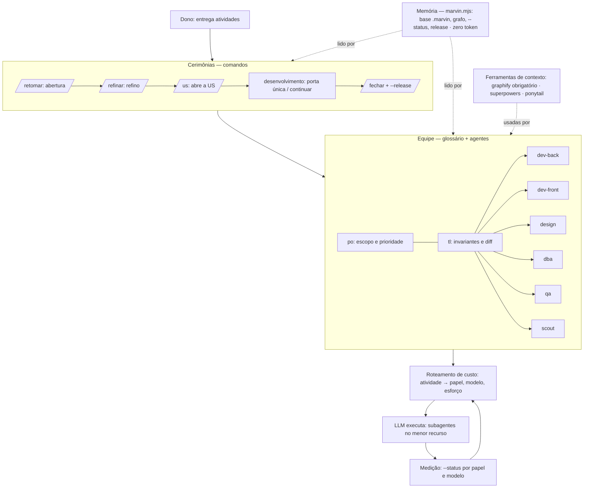

# O Marvin é a carapaça da LLM: uma equipe barata de desenvolvimento

**Quando:** 15/10/2026   ·   **Estado:** aceita pelo dono — aplicação por fases (ver *Plano estratégico*)
**Decisão de origem:** [decisoes-fechadas.md](decisoes-fechadas.md), entrada "O que o Marvin é".

## O que é

A LLM sozinha executa, mas não lembra, não planeja e não controla o próprio gasto. O Marvin é
a **carapaça** que se põe em volta dela: um conjunto de ferramentas que dá à LLM memória, uma
equipe com papéis definidos, cerimônias de trabalho e controle de custo. Funciona como uma
**equipe terceirizada barata**: você contrata o serviço, entrega as atividades, e ela devolve o
**mesmo resultado** que uma equipe cara, **gastando o mínimo de token**.

Sem o Marvin, o pedido é "Claude, faça", e a LLM gasta à vontade: relê o repositório, usa o
modelo mais caro para tudo e esquece entre sessões. Com o Marvin:
- ela lembra pelo **grafo**;
- planeja como um **Scrum Master**;
- cada tarefa vai para o **menor recurso** que entrega o mesmo resultado.

**A régua de toda decisão:** *entrega o mesmo resultado gastando menos?* Se não responde
isso, não entra.

## As camadas



| Camada | O que faz | Onde mora | Gasta token? |
|---|---|---|---|
| **C1 Memória** | guarda e devolve o estado: base `.marvin/`, grafo de código e de US, listagem do que está pendente, release | `marvin.mjs` (determinístico, zero dependência), `graphify-out/`, `.marvin/` | **não** — é Node puro; só o texto que entra no contexto |
| **C2 Equipe** | quem faz o quê: papéis com especialidade e atribuição; armadilhas do projeto | glossário `Contexto/Equipe.md` (lido na triagem) + `.claude/agents/*.md` (só papel que o projeto usa) | só quando o papel é chamado |
| **C3 Cerimônias** | o rito Scrum: abrir, refinar, desenvolver, fechar | `.claude/commands/` + painel `index.html` (`--status --html`): a fila anotada/refinada é a tela de refino; as ativas com *Time* são a tela de desenvolvimento | o mínimo de cada rito |
| **C4 Roteamento de custo** | escolhe papel, modelo e esforço por atividade, começando do mais barato | [delegacao.md](../Fluxos/delegacao.md) + tabela de partida | é o que **economiza** |
| **C5 Ferramentas de contexto** | reduzem o que a LLM precisa ler; **instaladas pelo Marvin no escopo do projeto, nunca globais** (US-50) | graphify (estrutura), superpowers e ECC (execução: TDD, build-fix, revisão em contexto limpo, segurança), ponytail (simplicidade) | custam para poupar mais; sem par medido em 2 US, sai do registro (`ferramentas.md`: não) |
| **Medição** | fecha o ciclo: quanto custou por papel e modelo | `marvin --status` (US-41) | não |

**A fronteira que não muda:** o **script** é memória e diagnóstico, determinístico e sem LLM.
A **orquestração** é dos agentes e dos comandos, isto é, da LLM guiada pela base. Por isso o
Marvin continua sem dependência e sem rodar nada em background.

## Ponto de partida no Claude (dono, 15/10/2026)

O Claude é o fornecedor principal. Cada papel começa aqui; o motivo para sair do degrau vai no *Time*.

| Modelo | Papéis | Quando |
|---|---|---|
| **Haiku** | `scout` (acha arquivo para dev, `po` e `tl`); `dev-*`, `qa`, `design`, `dba` | tarefa simples e bem especificada: localizar, mudança mecânica, conferência |
| **Sonnet** | `dev-back`, `dev-front`, `qa`, `design`, `dba` | o trabalho normal de execução |
| **Opus** | `tl`, `po` | julgamento: escopo, invariantes, leitura de diff |

**Regra do sênior:** começa no degrau mais barato que serve e a verificação (`qa`, teste) confere.
Só sobe se falhar. Esforço começa baixo, porque uma spec clara faz o pensamento antes.

**O roteador tem que ser barato.** Quem aplica esta tabela é regra escrita e o comando, não
uma chamada de Opus por atividade. O Opus entra quando há julgamento, e atividade trivial vai
direto (regra de custo 8).

Referência: reel de @donimas (15/10/2026), custo por tarefa resolvida nas mesmas 6 tarefas:
modelo top em tudo $5,10; escolha à mão $0,75; o mais barato primeiro, verifica e sobe $0,45;
roteador barato $0,32. É uma simulação do autor, não um benchmark. O número do Marvin vem da US-29.

## O fluxo de uma atividade

1. **Entrada.** O dono entrega uma ou várias atividades: frase, print ou bug.
2. **Listar sem custo.** O hook de sessão (`--status --curto`) já mostra o que está ativo, a
   fila e as ilhas, vindo do grafo e sem LLM.
3. **Refino** (`/refinar`, `po` + `tl` em paralelo). Cada atividade vira um nó da hierarquia, com
   *Pronto quando*, *Código tocado* e *Não entra*. **Passo de estrutura:** `graphify affected`
   e `graphify explain` só sobre os símbolos do *Código tocado*, com a linha da resposta registrada no
   *Time*, nunca o relatório colado.
4. **Triagem de custo** (`tl` + `po`). Para cada etapa, escolhem papel, modelo e esforço pela
   tabela de partida, do menor recurso que entrega o resultado. Subir de degrau exige motivo no *Time*.
5. **Desenvolvimento** (porta única ou `/continuar`). Subagentes executam: `dev-*` implementa,
   `qa` verifica e o `tl` lê o diff. Um escritor por arquivo de cada vez.
6. **Fechar** (`/fechar`, `--release`). Rumo, Evidência, release; a US sai da nota.
7. **Medir.** O `--status` dá o custo por papel, modelo e esforço, mas **não por atividade**.
   Atribuir custo a uma US ou Task exige sessão própria ou corte de turnos registrado (US-29).
   É o número que confirma ou corrige o ponto de partida.

## Hierarquia de trabalho (Scrum)

```
Epic → Feature → US | Defect → Task
```

- **Epic e Feature** agrupam, como hoje.
- **US** é valor novo. **Defect** é um defeito com causa e reprodução: hoje é US em `Manutencao/`
  e passa a ter tipo próprio.
- **Task** é a etapa executável de uma US ou Defect, com papel, modelo e esforço. É o que vai para
  o subagente. Hoje vive como linha do *Time*; passa a ser nó do grafo quando a US de
  hierarquia pedir.
- **Estados:** `anotada` (fora da fila) → `refinada` (na fila) → `ativa` (na nota) →
  `concluida` → release. Também `cancelada`.

## Regras de custo (onde o token vai)

1. **O que carrega em toda sessão é o mínimo**: `AGENTS.md`, `CLAUDE.md`, a nota e o hook. O
   resto carrega sob demanda. O passo 4b do script mede isso.
2. **O glossário da equipe não é agente.** Ele fica em `Contexto/Equipe.md`, lido só na
   triagem, cabe numa tabela (uma linha por papel) e não se confunde com as "Entradas do
   glossário" do `IA.md`, que são de modelos. `.claude/agents/` tem só o papel que o projeto usa,
   com as armadilhas daquele código.
3. **Localizar é Grep; estrutura é grafo.** Medido: ~18 tk contra ~1.650 para localizar. O grafo
   paga em "quem depende do quê".
4. **Execução começa no degrau mais barato.** Quem executa não herda o modelo de quem decidiu (US-42).
5. **Subagente nasce sem memória**, então o prompt de delegação leva só o necessário: o
   contrato da US, os arquivos e o check.
6. **Sessão longa custa em toda requisição**: registrar e abrir chat novo (`/retomar`).
   Orquestrar N atividades = refinar as N num chat e executar cada uma em rodada própria.
7. **Sem medição, economia é promessa.** Nenhuma regra desta lista vira verdade sem a US-29.
8. **A conta é da atividade inteira**, triagem incluída. Atividade cujo contexto de triagem
   custaria mais que fazê-la vai direto (passo 1 do `delegacao.md`): sem refino, sem triagem formal.

## Estado atual × alvo

| Peça | Hoje | Falta | US |
|---|---|---|---|
| Memória e listagem sem custo | ✅ `--status`, hook de sessão, base em grafo | — | — |
| Grafo de código e de US, fresco | ✅ hook `post-commit` e passo de estrutura obrigatório (15/10) | documentação religada a cada commit (edição manual do hook) | — |
| Papéis definidos na instalação | 🟡 tabela de papéis no `AGENTS.md` gerado, que carrega em toda sessão | mover para `Equipe.md`, lido só na triagem, com "quando entra" e "o que não faz" | [US-44](../../Planejamento/Novos/time/glossario/US-44-glossario-da-equipe/Sobre.md) |
| Porta única de orquestração | 🟡 ritos separados (`/refinar`, `/us`, `/continuar`) | "toma minhas atividades e orquestra" | [US-45](../../Planejamento/Novos/time/orquestracao/US-45-porta-unica/Sobre.md) |
| Modelo e esforço por atividade | 🟡 ponto de partida no Claude decidido pelo dono (seção acima); política (US-19, US-42) | levar a tabela ao `Equipe.md` gerado; confirmar ou corrigir com o par medido (US-29) | [US-29](../../Planejamento/Novos/time/roteamento/US-29-medir-economia-do-roteamento/Sobre.md) |
| Telas de refino e desenvolvimento | 🟡 painel único (US-36) | separar as duas visões, se o uso pedir | — |
| Defect e Task | 🔴 só Epic, Feature e US | tipos novos no script, `--status` e painel | [US-47](../../Planejamento/Novos/organizacao-por-grafo/hierarquia/US-47-defect-e-task/Sobre.md) |
| Superpowers e ECC em uso | 🔴 Superpowers só citado (US-25); ECC instalado à mão no perfil global, com agentes que disputam papel com a equipe do Marvin | avaliar os dois como ferramentas de execução da C5, chamadas pela equipe, nunca como segunda equipe | [US-48](../../Planejamento/Novos/ferramentas-opcionais/adaptadores/US-48-superpowers-e-ecc/Sobre.md) |
| Identidade pública | 🔴 README: "monta a base e sai da frente" | "equipe barata" nos dois READMEs | [US-49](../../Planejamento/Manutencao/publicacao/identidade/US-49-identidade-equipe-barata/Sobre.md) |
| Marvin como plugin único e curador por projeto | 🔴 ferramentas eram globais (limpas em 15/10, backup reversível) | o Marvin instala ECC, graphify, ponytail e Superpowers no escopo do projeto | [US-50](../../Planejamento/Novos/ferramentas-opcionais/curadoria/US-50-marvin-plugin-e-curador/Sobre.md) |
| Prova de economia | 🔴 custo medido (US-41), nenhuma amostra | pares medidos | [US-29](../../Planejamento/Novos/time/roteamento/US-29-medir-economia-do-roteamento/Sobre.md) |
| Grafo como rota de busca | 🟡 regra atual: Grep localiza | medir Grep × grafo | [US-43](../../Planejamento/Manutencao/ferramentas-opcionais/adaptadores/US-43-grafo-rota-de-busca/Sobre.md) |

## Plano estratégico

**Objetivo:** o Marvin entrega o mesmo resultado de uma equipe pelo menor custo de token, como
único plugin do Claude, curando as ferramentas por projeto.

**Como se mede**, nos mesmos três números em toda fase:

| Métrica | Fonte | Hoje (15/10) | Alvo |
|---|---|---|---|
| Contexto fixo por sessão | `/context` num chat novo e passo 4b | 74,8k, dos quais `AGENTS.md` 5,7k | ≤ 50k; `AGENTS.md` ≤ 3k |
| Contexto fixo medido sem UI (15/10, depois da 2.10.0) | `claude -p "Responda apenas: ok" --output-format json` → soma de `input`+`cache_*` | **55,6k** neste repo · 49,1k numa pasta vazia · 39,4k sem nenhum MCP. Repo = 6,5k (o `AGENTS.md` antigo pesava +1,4k); conectores/MCP da conta = 9,7k; Claude Code = 39,4k, fora do nosso alcance | o que sobra para cortar: conectores (dono) e os 6,5k do repo |
| Custo por tarefa aprovada | `--status` por papel e corte de turnos (US-29) | sem amostra | cai a cada fase, com a mesma aprovação |
| Execução fora do Opus | linhas do *Time* | não medido | a maior parte em Sonnet e Haiku; Opus só em julgamento |

**Portão:** nenhuma fase começa sem os três números da anterior registrados. Uma US de núcleo
(`marvin.mjs`, `ATUALIZACOES`) ativa por vez.

### Fase 0 — Limpeza ✅ (15/10/2026)

- Perfil global sem ECC, plugins, hooks nem MCP, com backup reversível. Base medida: **74,8k**.
- Ponto de partida no Claude decidido. Os agentes do repo já seguem: Opus para `tl`/`po`,
  Sonnet para `dev-back`/`qa` e Haiku para o `scout`.
- Grafo obrigatório no passo de estrutura, mantido fresco pelo hook `post-commit`.

### Fase 1 — Contexto fixo mínimo (o que toda sessão paga)

- **US-49 identidade.** README em "equipe barata". Barata, e tira a mentira pública.
- **US-44 glossário.** A tabela de papéis sai do `AGENTS.md` gerado para `Equipe.md`, lido só na
  triagem. O invariante 4 muda aqui. O `AGENTS.md` **deste repo** também desce de 5,7k para ≤ 3k:
  o que é regra de comando volta ao comando ("regra mora onde dispara").
- **Sai com:** `/context` de novo; Memory files menor.

### Fase 2 — Prova (portão de tudo que vem depois)

- **US-29 com 2 amostras.** As US-49 e US-44 contam, com papel, modelo e esforço declarados antes
  de rodar e o corte de turnos registrado.
- Aplica a regra do sênior (o mais barato que serve, verifica, sobe se falhar) e mede quanto saiu
  do Opus.
- **Sai com:** custo por tarefa aprovada, e a tabela de partida confirmada ou corrigida pelo par
  medido. Se não economizou, o plano para aqui e o Rumo diz por quê.

### Fase 3 — Curador (o Marvin vira o único plugin)

- **US-50 plugin e curador.** `marvin` num projeto instala no **escopo do projeto** só o que o
  registro diz: graphify, ponytail e, conforme a **US-48** (dentro desta fase), ECC e Superpowers.
  Avalia o empacotamento como plugin do Claude sem `dependencies`.
- **Sai com:** contexto fixo de um projeto com o curador, comparado ao da Fase 1. Nada volta para
  o global.

### Fase 4 — Orquestração (a equipe trabalha sozinha)

- **US-45 porta única** e **US-47 Defect e Task**. Cada uma depende de uma decisão do dono, que
  está no ❓ de cada US.
- O roteamento é **regra escrita** aplicada pelo comando, sem chamada de Opus por atividade.
- **Sai com:** custo por atividade entregue pela porta única × conduzida à mão (US-29).

### Fase 5 — Grafo como rota de busca (só se o número mandar)

- **US-43.** Grep × grafo em "onde está X". Só muda a regra "Grep localiza" se a medição sustentar.

### Guardas (como se obedece a letra e se gasta mais)

- **Triagem cara para tarefa barata.** Atividade trivial vai direto, sem refino (regra de custo 8).
- **N atividades num chat só.** Refina as N juntas e executa cada uma em rodada própria (regra 6).
- **O script cresce e ninguém vê.** As ~4.400 linhas não custam token, porque o script não é
  lido. O que custa é **o que ele gera** e carrega em toda sessão. Toda US mostra o 4b antes e
  depois.
- **Ferramenta que "custa para poupar".** Sem par medido em 2 US, sai do registro.

## O que continua valendo

- **Invariantes 1, 2 e 3** sem mudança: não destruir sem conferir, idempotência, não inventar
  convenção de ferramenta.
- **Invariante 4, com a mudança de 15/10:** o script pode escrever o **glossário genérico** da
  equipe, mas nunca as armadilhas de um projeto específico nem um agente "para preencher a pasta".
- **Zero dependência** no `package.json`. O graphify e o superpowers são instalados à parte.
- **O hook do Claude que obriga consultar o grafo a cada Read continua recusado.** O frescor
  vem do hook de git, e a consulta vem do passo de estrutura.

## ❓

- ~~"Carapaça/plugin": metáfora ou empacotamento?~~ Respondido em 15/10: empacotamento. O Marvin é
  o único plugin do Claude e instala as ferramentas por projeto (US-50).

Decisões relacionadas: as entradas de 15/10/2026 em [decisoes-fechadas.md](decisoes-fechadas.md).
